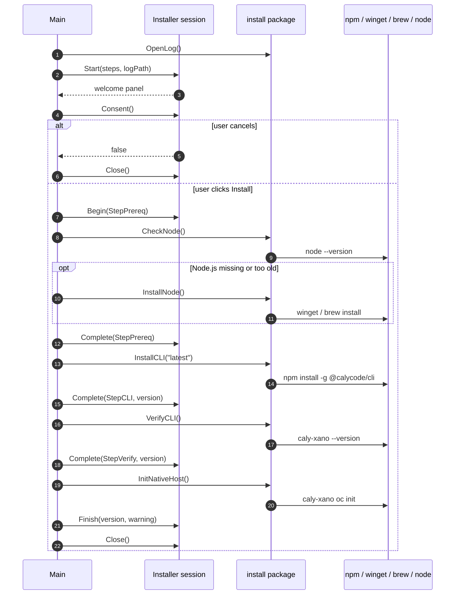
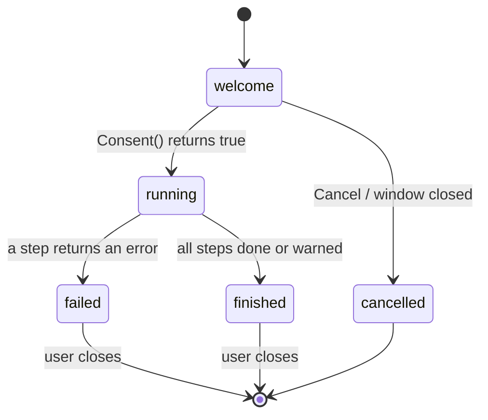
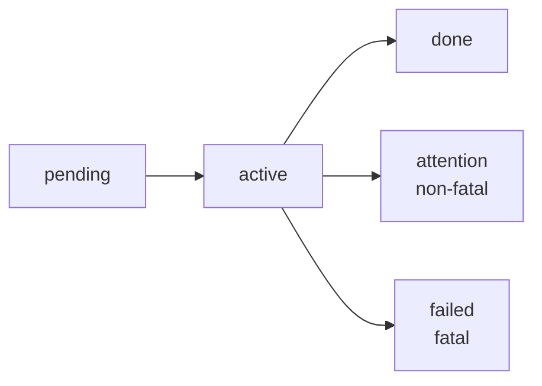
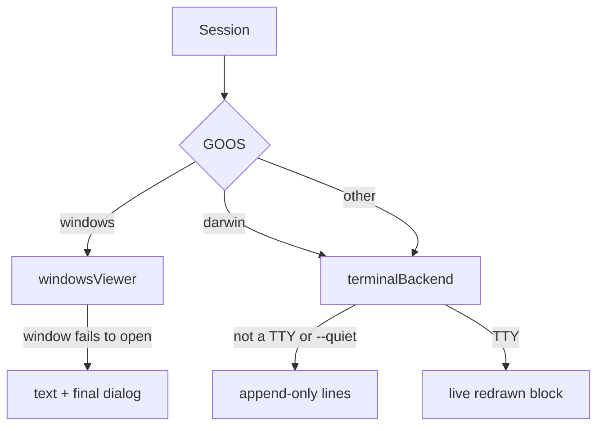
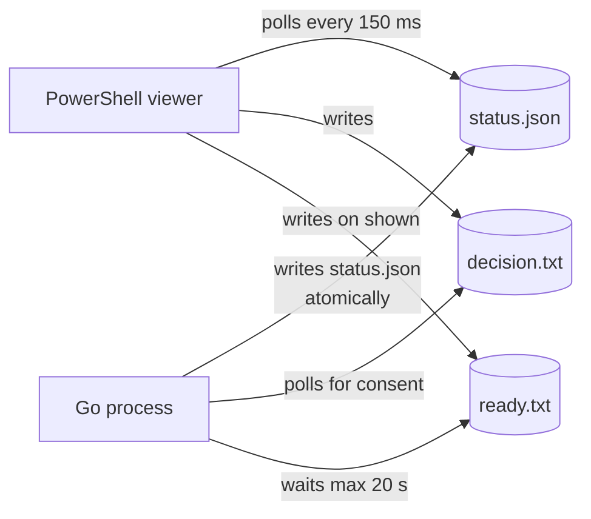

# CalyCode installer (bootstrapper)

A small Go program that installs the `@calycode/cli` npm package and connects the
CalyCode browser extension. It ships as a double-clickable `.exe` for Windows and
a zipped binary for macOS, and it is built from this directory.

The user-facing walkthrough lives in
[`docs/guides/installer.md`](../docs/guides/installer.md). This document is for
people changing the installer.

## Design goals

| Goal | How this code meets it |
| --- | --- |
| One window, no terminal | Windows renders a PowerShell/WinForms window; macOS renders one live terminal block. No stacked modal dialogs. |
| Explain every step | Each step carries a title, a live `detail`, and a `why`, all rendered in the same model. |
| Always leave evidence | Every run writes a timestamped log with commands, exit codes and output tails. |
| Never hang silently | Every child process has a timeout; a stuck package manager is killed and reported. |
| Degrade, don't dead-end | If the window cannot open, setup continues in text mode and reports through a final dialog. |

## Install flow



The window is open the whole time. Steps never pop a dialog of their own.

## The state model

Everything the user sees comes from one struct, `ui.Model`. A backend only paints
it; it never invents copy. That is why the Windows window and the macOS terminal
tell the same story.



Each step is in one of five states:



`attention` exists for the browser-integration step: the CLI is installed and
usable, only the extension connection is missing. Reporting that as a hard failure
would be misleading.

## Backends



All three render the same `Model`. The terminal backend redraws a single block
with ANSI escape codes and degrades to one line per change when stdout is not a
terminal, which keeps CI logs readable.

### Windows: status-file window



Why this shape:

- **PowerShell is the UI toolkit.** WinForms ships with Windows and needs no
  Go GUI dependency, no CGO, and no extra DLLs next to the binary.
- **The Go process owns the copy.** The `.ps1` contains no user-facing strings,
  so adding a language never means touching PowerShell.
- **A file handshake beats IPC.** One JSON file plus two one-word files have no
  sockets to leak, no ports to collide, and are trivial to inspect when debugging.

Two Windows-specific traps are encoded here:

1. `-WindowStyle Hidden` (and Go's `SysProcAttr.HideWindow`) set
   `STARTUPINFO.wShowWindow = SW_HIDE`, and Windows applies that show-state to
   **the first window the process creates** — which is the installer form. The
   form opened invisible. The script now forces `ShowWindow(form, SW_SHOW)` and
   then hides the console, so the console never flashes and the window is visible.
2. PowerShell 5.1 reads `.ps1` files without a BOM using the ANSI code page, which
   mangles glyphs like `✔`. The Go side writes the script with a UTF-8 BOM, and
   the viewer reads the status JSON with `Encoding.UTF8` explicitly.

### macOS: one live terminal block

Double-clicking the binary opens Terminal. Instead of osascript dialogs (a stack
of modal windows, one per step), the backend draws a single block in place:
brand, headline, checklist with spinner, progress bar, `Why this matters`, and
the log path. It waits for Enter at the end so the next steps stay readable.

`NO_COLOR` disables colour; a non-TTY falls back to plain lines.

## Timeouts

| Operation | Limit |
| --- | --- |
| `winget` / `choco` / `brew install` | 25 minutes |
| `npm install -g` | 10 minutes |
| `caly-xano --version` | 2 minutes |
| `caly-xano oc init` | 10 minutes |

A timeout is reported like any other failure, with the tail of the output and a
pointer to the log. The installer does not retry blindly.

## Logs

| Platform | Path |
| --- | --- |
| Windows | `%LOCALAPPDATA%\CalyCode\logs\installer-<timestamp>.log` |
| macOS | `~/Library/Logs/CalyCode/installer-<timestamp>.log` |
| Override | `CALYCODE_LOG_DIR` |

Every command is logged as `$ argv`, then `finished in … (exit code N)`, then
`stdout:` / `stderr:` blocks. Error dialogs show only the tail (1200 characters):
package managers can emit thousands of lines and a dialog is not the place for
them.

The Windows viewer also writes `viewer.log` in its temporary directory, which is
deleted when the window closes. When the window fails to start, the reason lands
in the setup log instead (`viewer: …` lines).

## Copy and languages

English is the source of truth in `i18n/catalog_en.go`. Other languages override
only what they translate; anything missing falls back to English rather than
showing a blank label or a raw key.

`i18n/i18n_test.go` fails the build when:

- a translation names a key that does not exist;
- a translation drops a `%s`/`%d` verb;
- a language is missing a translation;
- Go source calls `T("…")` with a key that is not in the catalog.

To add a language: add an entry to `translations` in
`i18n/catalog_translations.go`, add it to the locale switch in `selectCatalog`,
then run `go test ./...` until it is quiet. No backend changes are needed.

## Layout

```
bootstrapper/
├── main.go                     # flags, log, consent, the four steps
├── install/
│   ├── cli.go                  # npm install, verify, native host
│   ├── node.go                 # version probe + parsing
│   ├── node_windows.go         # winget → Chocolatey
│   ├── node_darwin.go          # Homebrew (only when already present)
│   ├── log.go                  # setup log + command runner with timeouts
│   ├── exec_windows.go         # .cmd shims, PATH refresh, hidden consoles
│   ├── exec_darwin.go          # Homebrew PATH refresh
│   └── exec_unsupported.go
├── ui/
│   ├── session.go              # Model, Session, steps, phases, heartbeat
│   ├── backend_terminal.go     # ANSI renderer + consent prompt
│   ├── session_windows.go      # status-file viewer backend
│   ├── viewer_script_windows.go# the PowerShell window (no strings, no logic)
│   ├── dialog_windows.go       # MessageBox fallback only
│   ├── session_darwin.go
│   └── session_unsupported.go
├── i18n/                       # English source + overrides
├── preview/                    # developer UI sandbox (not shipped)
└── Makefile                    # cross-compile targets
```

## Building

```bash
cd bootstrapper

go test ./...        # unit tests (copy, parsing, rendering)
go build ./...       # native build

make all             # dist/calycode-installer-{windows-x64.exe,darwin-arm64,darwin-x64}
make windows
make darwin-arm64
```

The release workflow (`.github/workflows/build-bootstrapper.yml`) cross-compiles
`linux → windows/darwin` with `CGO_ENABLED=0`, zips the macOS binaries, writes
`SHA256SUMS`, and attaches everything to the GitHub release that changesets
created. The version shown by `--version` is injected with
`-ldflags "-X main.version=…"`; plain `go build` reports `dev`.

## Previewing the UI

`preview/` renders a scripted state so you can iterate on the window without
installing anything:

```bash
go run ./preview -stage welcome
go run ./preview -stage running
go run ./preview -stage done
go run ./preview -stage failed
go run ./preview -stage welcome -lang de   # check long strings
go run ./preview -stage running -quiet     # check the text backend
go run ./preview -stage running -consent   # exercise the install/cancel handshake
```

On Windows this opens the real window with the real PowerShell script. Close it
to exit.

## Things that look odd on purpose

| Decision | Reason |
| --- | --- |
| No `osascript` dialogs on macOS | One window beats a modal dialog per step, and a dialog cannot show a checklist or progress. |
| No automatic Homebrew install | Homebrew's installer needs an interactive administrator password; a background step would hang or fail obscurely. A clear "install Node.js from nodejs.org" is kinder. |
| `npm` runs through `cmd /c` on Windows | `CreateProcess` cannot execute the `npm.cmd` shim directly. |
| PATH is refreshed mid-run | `winget` and `npm -g` change PATH for *new* processes; setup should not require a reboot. |
| The window has no close button while running | Closing mid-install would hide what is happening and orphan a running package manager. Close appears when the run ends; a watchdog reveals it if setup stops reporting for 10 minutes. |
| Error dialogs show only the tail | The full output is in the log, which is one click away. |
