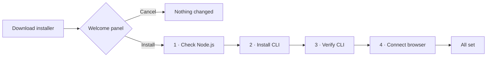
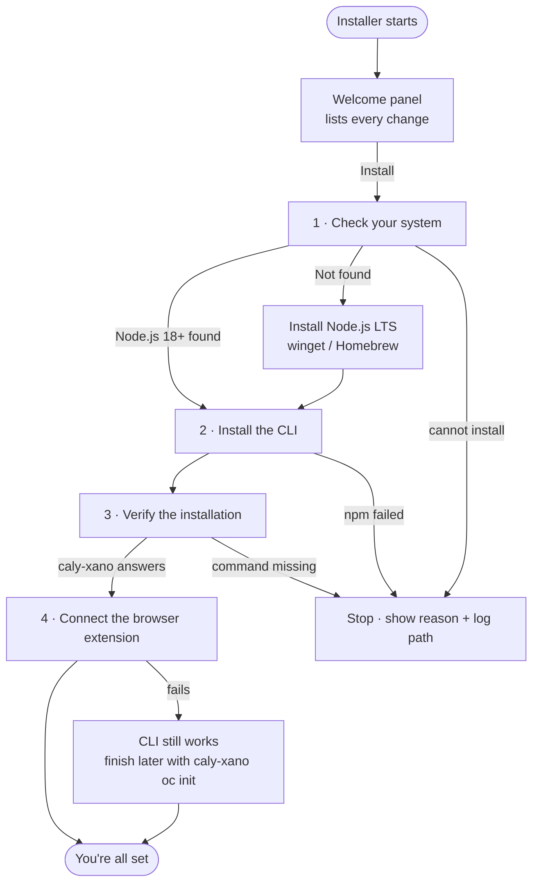
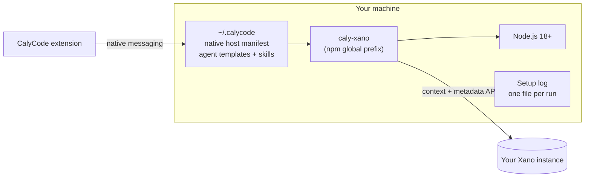

# Installing the CalyCode CLI

The CalyCode installer sets up everything you need to work with Xano from your terminal **and** from the browser extension. It runs in one window, explains every step as it happens, and writes a full log you can inspect afterwards.

It takes about a minute.



## Before you start

| Requirement | Notes |
| --- | --- |
| Internet connection | The CLI comes from the npm registry; the browser integration downloads agent templates from GitHub. |
| Windows 10/11 or macOS | Linux users should use the terminal installer (`curl … \| bash`). |
| Node.js 18+ | Checked in step 1. If it is missing, setup installs the current LTS release for you. |
| No administrator rights | Everything installs into your own user account, except Node.js itself, which may ask for a UAC prompt on Windows. |

## Download

| Platform | File |
| --- | --- |
| Windows x64 | `calycode-installer-windows-x64.exe` |
| macOS Apple Silicon | `calycode-installer-darwin-arm64.zip` |
| macOS Intel | `calycode-installer-darwin-x64.zip` |

All three are attached to the [latest release](https://github.com/calycode/xano-tools/releases/latest), together with a `SHA256SUMS` file.

> **macOS:** unzip the download, then right-click the installer and choose **Open** the first time. macOS treats unsigned binaries as quarantined until you approve them. After that, double-clicking works normally.

## What the installer does



Every step is visible in the window while it runs. The list below mirrors what you see there, including the reason each step exists.

### 1 · Check your system

**You see:** `Node.js v20.11.0 detected.` — or a live line saying Node.js is being installed.

**What happens:** setup looks for `node` on your `PATH` and checks that it is version 18 or newer. If it is missing, the system package manager installs the LTS release:

| Platform | Package manager |
| --- | --- |
| Windows | `winget` (`OpenJS.NodeJS.LTS`), falling back to Chocolatey |
| macOS | Homebrew (`brew install node`) when Homebrew is already installed |

**Why it matters:** Node.js runs the CLI and every tool it launches. Installing it first means the rest of setup cannot fail halfway through.

> **macOS note:** setup does not install Homebrew, because Homebrew's installer needs an administrator password that a background step cannot answer. If Homebrew is missing, install Node.js from [nodejs.org](https://nodejs.org) and run the installer again.

### 2 · Install the CalyCode CLI

**You see:** `Updating from 1.4.2 to the latest release…` (or a plain install line on a fresh machine), then `CLI 1.5.0 installed.`

**What happens:** `npm install -g @calycode/cli` runs in the background. Everything npm prints is captured in the setup log.

**Why it matters:** this adds the `caly-xano` command, which generates code, docs, OpenAPI specs, repositories and tests from your Xano workspace.

### 3 · Verify the installation

**You see:** `caly-xano 1.5.0 answers correctly.`

**What happens:** setup refreshes `PATH` for anything installed a moment ago and runs `caly-xano --version` in a subprocess.

**Why it matters:** it proves the command works before you are told setup succeeded, so a broken install does not surface later as a mysterious "command not found".

### 4 · Connect the browser extension

**You see:** `Browser integration and agent templates are ready.`

**What happens:** setup runs `caly-xano oc init`, which:

- registers the native messaging host so the CalyCode browser extension can talk to the CLI on your machine;
- installs the OpenCode agent templates and the Xano skills the CLI uses.

**Why it matters:** this is what lets you drive Xano work from the browser, and gives the AI agent Xano-specific knowledge instead of generic guesses.

If this step fails, the CLI still works. The window marks the step as **Needs attention** and tells you the one command to finish it later:

```bash
caly-xano oc init
```

## Where everything lands



| Item | Windows | macOS |
| --- | --- | --- |
| `caly-xano` | `%APPDATA%\npm` | Homebrew or npm global prefix |
| Native host + agent files | `%USERPROFILE%\.calycode` | `~/.calycode` |
| Browser registration | `HKCU\Software\Google\Chrome\NativeMessagingHosts` (also Brave, Edge, Chromium) | `~/Library/Application Support/<browser>/NativeMessagingHosts` |
| Setup log | `%LOCALAPPDATA%\CalyCode\logs` | `~/Library/Logs/CalyCode` |

The welcome panel and the completion panel both print the exact log path for the run.

## The setup log

Every run writes a timestamped log. It contains the command lines setup ran, their exit codes, and the tail of their output. The log stays on your machine: it is never uploaded, and it contains no workspace data.

The window links to it directly:

- **Open setup log** opens it in your default text editor.
- **Copy log path** copies the path, ready to paste into a support request.

Set `CALYCODE_LOG_DIR` to write logs somewhere else.

## When something goes wrong

The installer stops at the first step it cannot finish, keeps the window open, and shows the reason plus the log path. The table below maps what you see to what to do.

| Message | What it means | What to do |
| --- | --- | --- |
| `Node.js is required` | Node.js 18+ is missing and could not be installed automatically. | Install it from [nodejs.org](https://nodejs.org), then run the installer again. |
| `npm is missing` | Node.js exists but npm is not on `PATH`. | Reinstall Node.js from [nodejs.org](https://nodejs.org). |
| `The CLI could not be installed` | npm refused the install, usually a network or permissions problem. | Check the log. If it mentions `EACCES`, see [npm's permissions guide](https://docs.npmjs.com/resolving-eacces-permissions-errors-when-installing-packages-globally), or install manually: `npm install -g @calycode/cli`. |
| `The CLI did not respond` | The package installed but `caly-xano` does not run. | Open a new terminal and run `caly-xano --version`. If that fails, reinstall with `npm install -g @calycode/cli`. |
| `Browser integration is incomplete` | The CLI works; only the extension connection is missing. | Run `caly-xano oc init`, then reload the browser. |
| The window never opens | PowerShell or the desktop environment blocked it. | Setup continues in text mode and reports the outcome in a dialog; the log records why. On Windows you can also run the installer with `--quiet` in a terminal. |

### Checking the browser connection

```bash
caly-xano oc native-host status
```

This prints the manifest paths, the wrapper, and which extension IDs are allowed.

## Silent and scripted installs

The installer accepts a few flags, which is useful for provisioning machines or CI images:

```bash
# Print plain progress to stdout, no window
calycode-installer-windows-x64.exe --quiet

# Report the installer build
calycode-installer-windows-x64.exe --version

# Force a language (en, es, de, fr, hu, sr)
CALYCODE_LANG=de calycode-installer-windows-x64.exe
```

Exit codes: `0` success or cancelled before starting, `1` setup stopped at a step, `2` invalid arguments.

## Undoing an install

```bash
npm uninstall -g @calycode/cli
```

Then remove the integration files:

- `~/.calycode` (macOS/Linux) or `%USERPROFILE%\.calycode` (Windows) — native host manifest, agent templates, skills.
- Browser manifests listed by `caly-xano oc native-host status`, if you want them gone before running the command above.
- The setup log folder, if you no longer need it.

## After setup

1. Reload the browser tab where you use the CalyCode extension.
2. Open a new terminal and run `caly-xano --help`.
3. Connect your Xano instance with `caly-xano init`, then start generating with `caly-xano generate`.

New to the CLI? Continue with [Getting Started](/docs/guides/git-workflow.md) or the [OpenCode setup guide](/docs/guides/opencode-setup.md).
